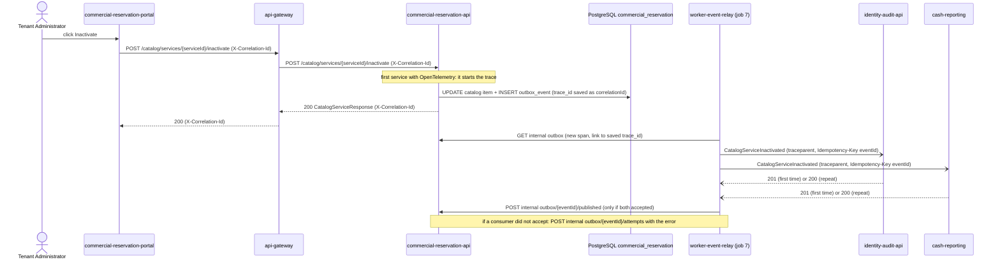

# CP1 - Critical journey and trace map

## Journey

**Inactivate a catalog service** (HU-COM-001, RF-004), macrodomain 2 commercial-reservation.

The Tenant Administrator inactivates a tour or service in the operator portal. The item stops being
offered in new reservations and keeps its history. The change must reach the audit trail
(02 identity-audit) and the cash view (05 cash-reporting), so the journey crosses a synchronous part
and an asynchronous part.

Sources in the `multi-tour-docs` repository:

- `07-api/contracts/openapi/commercial-reservation.yaml`: `POST /catalog/services/{serviceId}/inactivate`,
  operationId `inactivateCatalogService`, role `TENANT_ADMINISTRATOR`, emits `CatalogServiceInactivated`.
- `09-microservices/event-catalog.md`: `CatalogServiceInactivated` is published by 03 commercial-reservation
  and delivered by worker job 7 to 02 identity-audit and 05 cash-reporting.
- `09-microservices/services/06-api-gateway/events.md`: the gateway reuses or creates `X-Correlation-Id`,
  forwards it and returns it. It does not validate the token (ADR-004 D10), so it does not know the tenant.
- `05-architecture/decisions/records/ADR-004-backend-microservices-macrodomain-split.md`, D4 (outbox contract
  with four internal routes) and D10 (worker timeouts and event retries).

## Hop table

| # | Caller | Callee | Protocol | Operation | Sync/Async | Data touched |
|---|---|---|---|---|---|---|
| 1 | Tenant Administrator | `multi-tour-commercial-reservation-portal` | browser | click "Inactivate" on a catalog item | sync | none |
| 2 | portal | `multi-tour-api-gateway` | REST | `POST /api/v1/catalog/services/{serviceId}/inactivate` | sync | none |
| 3 | `multi-tour-api-gateway` | `multi-tour-commercial-reservation-api` (port 8083) | REST | same path, same headers | sync | none |
| 4 | commercial-reservation-api | PostgreSQL, schema `commercial_reservation` | SQL | set `catalogStatus = INACTIVE` and insert the `outbox_event` row `CatalogServiceInactivated`, one transaction | sync | catalog item, `outbox_event` |
| 5 | `multi-tour-worker-event-relay` (job 7) | commercial-reservation-api | REST | `GET /api/v1/<domain>/internal/outbox?status=PENDING` (ADR-004 D4, route 1) | async (polling, every 5 s) | `outbox_event` |
| 6 | worker-event-relay | `multi-tour-identity-audit-api` | REST | `POST /api/v1/<domain>/internal/tenants/{tenantId}/events` with `Idempotency-Key: <eventId>`; answer `201` the first time, `200` for a repeat (route 2) | async | `audit_records` (MongoDB) |
| 7 | worker-event-relay | 05 cash-reporting | REST | same route and same `Idempotency-Key` (route 2) | async | cash-reporting reading of the catalog item (proposal) |
| 8 | worker-event-relay | commercial-reservation-api | REST | `POST .../internal/outbox/{eventId}/published` only after every consumer answered `201` or `200` (route 3); if one did not accept, `POST .../internal/outbox/{eventId}/attempts` with `{error}` (route 4) | async | `outbox_event` |

Status today: the relay of the product (`multi-tour-worker-event-relay`, `internal/config/routing.go`) knows
five event types (`TenantCreated`, `TenantInactivated`, `TenantReactivated`, `AccountSessionsRevoked`,
`AccountBlocked`) and `CatalogServiceInactivated` is not one of them, so hops 5 to 8 are designed, not built.
`identity-audit.yaml` does not publish the receiving route of hop 6 yet; the route above is the pattern of
ADR-004 D4, the same one that `security.yaml` already publishes (`/security/internal/tenants/{tenantId}/events`). The `<domain>` segment of 02 and 03 is assumed to be the service name; it is not published yet. Hop 7 depends on cash-reporting, which the
project owner keeps as portal only for now (its API and database are deferred), so hop 7 is a design too.
The `commercial-reservation` internal outbox routes are not written in `commercial-reservation.yaml` either.

## Sequence diagram



## Trace context on each hop

| Hops | Context that travels |
|---|---|
| 1 to 3 | `X-Correlation-Id`. The gateway reuses the incoming value or creates one, forwards it and returns it to the portal (`06-api-gateway/events.md`). The gateway only writes JSON logs; it does not create spans or `traceparent` (ADR-004 D8). |
| 4 | `commercial-reservation-api` is the first service with OpenTelemetry (Java agent, ADR-004 D8), so it starts the trace. It writes the `trace_id` into the `correlationId` field of the `outbox_event` envelope, so the context survives the transaction. |
| 5 | The relay reads `correlationId` from the envelope and starts its spans in the same trace. |
| 6 and 7 | `traceparent: 00-<trace_id 32 hex>-<span_id 16 hex>-01` built from the saved `trace_id` plus a new `span_id`, and `Idempotency-Key`. This is the asynchronous boundary: the context is stored in the row first, then sent as a header. |
| 8 | `published` or `attempts` calls of the relay carry the same `traceparent`. |

Open point: the docs define `X-Correlation-Id` for the gateway and show `traceparent` in
`13-operations/observability.md`. Using both, with the same value as `trace_id`, is my proposal.
It is not written in an ADR yet. If the API keeps a different `correlationId`, the relay starts a new trace.

## Span tree

```text
trace_id = 4bf92f3577b34da6a3ce929d0e0e4736
POST /catalog/services/{serviceId}/inactivate          (commercial-reservation-api, server, root)
  db.transaction inactivate + outbox insert            (commercial-reservation-api, internal)
(the api-gateway only forwards X-Correlation-Id and writes a JSON log line; it creates no span)
--- asynchronous boundary: same trace_id, read from outbox_event.correlationId ---
relay.poll outbox                                      (worker-event-relay, consumer)
  deliver CatalogServiceInactivated -> identity-audit  (worker-event-relay, producer)
    POST internal event                                (identity-audit-api, server)
      store audit record                               (identity-audit-api, internal)
  deliver CatalogServiceInactivated -> cash-reporting  (worker-event-relay, producer)
    POST internal event                                (cash-reporting, server)
  mark event published, or record the failed attempt   (worker-event-relay, client)
```

The `trace_id` above is an example value, not a real measurement.
