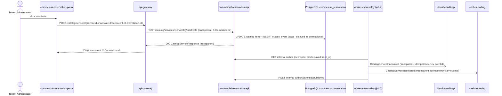

# CP1 - Critical journey and trace map

## Journey

**Inactivate a catalog service** (HU-COM-001, RF-004), domain D-02 commercial-reservation.

The Tenant Administrator inactivates a tour or service in the operator portal. The item stops being
offered in new reservations and keeps its history. The change must reach the audit trail
(02 identity-audit) and the cash view (05 cash-reporting), so the journey crosses a synchronous part
and an asynchronous part.

Sources in the `multi-tour-docs` repository:

- `07-api/contracts/openapi/commercial-reservation.yaml`: `POST /catalog/services/{serviceId}/inactivate`,
  operationId `inactivateCatalogService`, role `TENANT_ADMINISTRATOR`, emits `CatalogServiceInactivated`.
- `09-microservices/event-catalog.md`: `CatalogServiceInactivated` is published by 03 commercial-reservation
  and delivered by worker job 7 to 02 identity-audit and 05 cash-reporting.
- `09-microservices/services/06-api-gateway/events.md`: the gateway reuses or creates `X-Correlation-Id`,
  forwards it and returns it.

## Hop table

| # | Caller | Callee | Protocol | Operation | Sync/Async | Data touched |
|---|---|---|---|---|---|---|
| 1 | Tenant Administrator | `multi-tour-commercial-reservation-portal` | browser | click "Inactivate" on a catalog item | sync | none |
| 2 | portal | `multi-tour-api-gateway` | REST | `POST /api/v1/catalog/services/{serviceId}/inactivate` | sync | none |
| 3 | `multi-tour-api-gateway` | `multi-tour-commercial-reservation-api` (port 8083) | REST | same path, same headers | sync | none |
| 4 | commercial-reservation-api | PostgreSQL, schema `commercial_reservation` | SQL | set `catalogStatus = INACTIVE` and insert the `outbox_event` row `CatalogServiceInactivated`, one transaction | sync | catalog item, `outbox_event` |
| 5 | `multi-tour-worker-event-relay` (job 7) | commercial-reservation-api | REST | read the internal outbox, then mark the event published | async (polling) | `outbox_event` |
| 6 | worker-event-relay | `multi-tour-identity-audit-api` | REST | deliver `CatalogServiceInactivated` with `Idempotency-Key: <eventId>` | async | `audit_records` (MongoDB) |
| 7 | worker-event-relay | 05 cash-reporting | REST | deliver `CatalogServiceInactivated` with `Idempotency-Key: <eventId>` | async | cash-reporting copy of the catalog item |

Status today (from `event-catalog.md`, section "Implementation status"): the relay routing table knows five
event types and `CatalogServiceInactivated` is not one of them, so hops 5 to 7 are designed, not built.
The internal outbox routes for 03 follow the pattern already written for `security` and `identity-audit`.

## Sequence diagram



## Trace context on each hop

| Hops | Context that travels |
|---|---|
| 1 to 3 | `traceparent: 00-<trace_id 32 hex>-<span_id 16 hex>-01` and `X-Correlation-Id`. The gateway reuses the incoming values or creates them, and returns them to the portal. |
| 4 | Not a network call. The API writes the `trace_id` into the `correlationId` field of the `outbox_event` envelope, so the context survives the transaction. |
| 5 | The relay reads `correlationId` from the envelope and starts its spans in the same trace. |
| 6 and 7 | `traceparent` built from the saved `trace_id` plus a new `span_id`. This is the asynchronous boundary: the context is stored in the row first, then sent as a header. |

Open point: the docs define `X-Correlation-Id` for the gateway and show `traceparent` in
`13-operations/observability.md`. Using both, with the same value as `trace_id`, is my proposal.
It is not written in an ADR yet.

## Span tree

```text
trace_id = 4bf92f3577b34da6a3ce929d0e0e4736
POST /api/v1/catalog/services/{serviceId}/inactivate   (api-gateway, root)
  call commercial-reservation-api                      (api-gateway, client)
    POST /catalog/services/{serviceId}/inactivate      (commercial-reservation-api, server)
      db.transaction inactivate + outbox insert        (commercial-reservation-api, internal)
--- asynchronous boundary: same trace_id, read from outbox_event.correlationId ---
relay.poll outbox                                      (worker-event-relay, consumer)
  deliver CatalogServiceInactivated -> identity-audit  (worker-event-relay, producer)
    POST internal event                                (identity-audit-api, server)
      store audit record                               (identity-audit-api, internal)
  deliver CatalogServiceInactivated -> cash-reporting  (worker-event-relay, producer)
    POST internal event                                (cash-reporting, server)
  mark event published                                 (worker-event-relay, client)
```

The `trace_id` above is an example value, not a real measurement.
