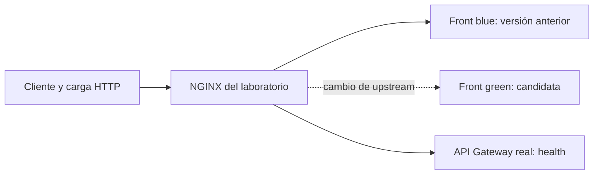

# Semana 12 · Sesión 2 — Planificación: despliegue, IaC y reversión

**Estudiante:** Maria Fernanda Robayo Laguna · **GitHub:** FernandaRobayo · **Equipo:** ErrorCapa8.
**Proyecto:** Multi Tour · **Fecha:** 2026-10-22.

La actividad consiste en redactar el plan de despliegue para MVP 3: promover un artefacto sin
reconstruirlo, reproducir ambientes mediante IaC, elegir una estrategia sin interrupciones,
ensayar una reversión documentada y cronometrada y dividir el trabajo en historias comprobables.

Esta entrega desarrolla ese plan y un ensayo local con las imágenes reales del front y gateway
ya utilizadas en [Sesión 1](../Sesión%201/README.md). No modifica repositorios del producto.

## 1. Guía de lectura

| Entregable | Qué contiene |
|---|---|
| [plan-despliegue.md](plan-despliegue.md) | Promoción, puertas de calidad, configuración, IaC, decisiones, datos y riesgos |
| [docker-compose.yml](docker-compose.yml), [env/](env/) y [proxy/nginx.conf](proxy/nginx.conf) | Mismo modelo de infraestructura para dev, qa y main locales |
| [ensayar.ps1](ensayar.ps1) | Preparación, comparación de imágenes, conmutación, reversión medida, prueba negativa y recreación |
| [runbook-reversion.md](runbook-reversion.md) | Procedimiento de reversión, verificación y escalamiento |
| [historias-mvp3.md](historias-mvp3.md) | Siete historias propuestas con criterios de aceptación, dependencias y estado real |
| [Evidencias/](Evidencias/) | Configuraciones resueltas, imágenes observadas, tráfico, bitácora y resultados |

## 2. Arquitectura del ensayo



Cada ambiente tiene proyecto/red/puerto propio: dev 8092, qa 8093, main 8094, solo en `127.0.0.1`.
Main significa **producción local simulada**, no un despliegue público. Solo el front usa blue-green;
el gateway mantiene una instancia fija. Los servicios de negocio y bases no forman parte del ensayo.

Las tres imágenes de aplicación y la del proxy se fijan por ID completo del almacén local, sin
`build` ni descargas. Los tres ambientes deben ejecutar esos mismos IDs. Las etiquetas legibles
v1.0.0/v2.0.0 de la sesión 1 son la referencia humana; el archivo de evidencia registra el contenido real.
El plan de MVP 3 exige digests de registro; este laboratorio no publica imágenes en un registro.

## 3. Cómo reproducir

Requisitos: Docker Desktop con Compose que soporte `--wait`, Windows PowerShell 5.1 o posterior,
puertos 8092–8094 libres y las cuatro imágenes locales referenciadas en `env/*.env.example`.
Los IDs de front corresponden a `multitour/front:v1.0.0` y `v2.0.0`; gateway a
`multitour/api-gateway:v2.0.0`; proxy a la imagen local de `nginx:1.27-alpine`.
En otra máquina hay que obtener los mismos artefactos confiables (por registro o `docker save/load`);
la entrega no contiene sus binarios. `pull_policy: never` hace fallar visiblemente si faltan.

Desde la raíz del repositorio:

```powershell
powershell -NoProfile -ExecutionPolicy Bypass -File '.\12-week\hu-status\Sesión 2\ensayar.ps1'
```

El script valida Compose, crea los contenedores, copia la configuración versionada antes de iniciar
NGINX y ejecuta las verificaciones. La copia evita una incompatibilidad de bind mounts observada con
Docker Desktop y la ruta Windows de esta carpeta. No cambia las imágenes ni utiliza `docker commit`.
La configuración se genera y copia de nuevo al recrear: no depende de editar un servidor manualmente.
`runtime/` es generado e ignorado; no debe contener secretos.

El ensayo invalida los resultados anteriores al comenzar y escribe `Evidencias/estado.json` con un
identificador de ejecución y estado `running`, `failed` o `passed`. `resultado.json` solo se publica
después de completar las verificaciones y la limpieza; un fallo no conserva un éxito anterior.
Los archivos `.sh` tienen LF obligatorio mediante `.gitattributes`, también al descargarlos en Windows.
El ensayo limpia sus contenedores/redes al terminar. No ejecutar simultáneamente dos instancias. Procedimiento manual y limpieza:
[runbook-reversion.md](runbook-reversion.md).

## 4. Comprobaciones y resultados

La ejecución comprueba:

1. Salud, respuesta de página, salud del gateway y configuración pública diferente por ambiente.
2. Mismos IDs de imagen en dev, qa y main y promoción a green sin recompilar.
3. En main: carga continua, vuelta a blue cronometrada y cinco comprobaciones de recuperación.
4. Rechazo del cambio a green detenida, conservando blue.
5. Recreación completa de los contenedores main con el mismo código de infraestructura.

Los valores medidos se publican en [Evidencias/resultado.json](Evidencias/resultado.json).
La comparación por ambiente está en [Evidencias/promocion-imagenes.json](Evidencias/promocion-imagenes.json).
La bitácora y el tráfico permiten verificar los resultados sin depender de capturas.

Prueba de regresión del manejo de errores (usa una copia aislada, no cambia las imágenes del ensayo):

```powershell
powershell -NoProfile -ExecutionPolicy Bypass -File '.\12-week\hu-status\Sesión 2\tests\verificar-fallo.ps1'
```

Su resultado está en [Evidencias/prueba-fallo.json](Evidencias/prueba-fallo.json): una imagen inexistente
produce salida distinta de cero, estado `failed` y eliminación del éxito anterior sembrado por la prueba.

Ejecución del **22 de octubre de 2026**, zona de Colombia (`-05:00`):

| Comprobación | Resultado observado |
|---|---|
| Mismos artefactos en dev, qa y main | Los cuatro IDs coinciden entre los tres ambientes |
| Promoción del front a green | Verificada en los tres ambientes |
| Reversión main a blue, incluida verificación | **7,363 segundos**, objetivo menor de 300 segundos |
| Tráfico continuo del front | **318 solicitudes**, 172 blue y 146 green; **0 fallidas** |
| Tráfico de salud del gateway | **318 solicitudes; 0 fallidas** |
| Destino green detenido | Cambio rechazado; blue siguió respondiendo |
| Recreación de main | Front y gateway respondieron 200 |
| Limpieza | Contenedores y redes del ensayo retirados |

Los números corresponden a una ejecución local con carga sintética. No son un SLO mensual ni una
medición de disponibilidad de todos los componentes de Multi Tour.

## 5. Alcance y pendientes de MVP 3

- La prueba de cero fallos se limita al tráfico HTTP sintético de la página y la salud del gateway.
  No prueba login, assets, portales, reservas ni disponibilidad continua del sistema completo.
- `/deployment-config.json` demuestra metadatos públicos por ambiente en el proxy; la SPA no lo consume.
  La configuración efectiva de Angular entre ambientes es una historia pendiente del producto.
- Registro, CI/CD y puertas automáticas son planificación. No se atribuye a las imágenes un commit
  de origen que no haya sido verificado, ni se presenta un ID local como digest de registro.
- No se ensayan bases ni migraciones. El plan exige respaldo, expand/contract y protección de volúmenes
  según Anexo J. Una reversión de front no revierte datos.
- Las historias DEP-* son propuestas locales para incorporar al tablero; no son HU oficiales ni se
  declaran implementadas en producción. La sesión académica termina con el plan y su ensayo acotado.

## 6. Autocomprobación de la sesión

| Pregunta | Respuesta |
|---|---|
| ¿Qué es promover un artefacto? | Ejecutar la misma imagen ya construida, cambiando solo configuración por ambiente |
| ¿Qué aporta IaC? | Infraestructura reproducible, versionada y revisable |
| ¿Cuándo es confiable la reversión? | Cuando se ha ensayado y verificado |
| ¿Qué estrategia permite conmutar y volver rápidamente? | Blue-green |
| ¿Qué es un servidor snowflake? | Una máquina configurada manualmente que no se puede reproducir de forma confiable |
| ¿Cuándo aporta confianza QA? | Cuando reproduce el modelo IaC de producción y prueba el mismo artefacto, con configuración y datos adecuados |
