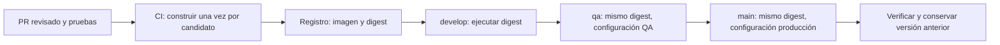

# Plan de despliegue MVP 3 — Multi Tour

Fecha: 2026-10-22 · Responsable de esta entrega: Maria Fernanda Robayo Laguna · Equipo: ErrorCapa8.
Plan académico basado en la sesión 1 y en la norma del docente (§6, §10, Anexos G y J).
Las decisiones siguientes son propuestas para MVP 3; la evidencia local se identifica por separado.

## 1. Alcance y decisiones

El objetivo es convertir el despliegue en una operación repetible y reversible. La unidad del ensayo es
el front real de Multi Tour (blue y green), el gateway real y un proxy NGINX de laboratorio.
El sistema completo incluye portales, seguridad, APIs, worker, workflow y bases de datos: su promoción
se planifica aquí, pero su funcionamiento integrado no queda demostrado por este ensayo.

| Decisión | Elegida y motivo | Alternativa y motivo de descarte para este ensayo |
|---|---|---|
| D-01 Artefacto | Construir una vez por candidato, identificar por digest de registro y promover ese digest | Reconstruir por ambiente produce artefactos distintos y pierde la evidencia de QA |
| D-02 IaC | Docker Compose y configuración NGINX versionada, adecuados al host disponible | Kubernetes añade un clúster que este proyecto académico no tiene; Terraform sería útil para provisionar infraestructura remota, que aquí no existe |
| D-03 Estrategia | Blue-green para el front sin estado; mantiene la versión anterior y permite volver cambiando el upstream | Rolling requiere controlar réplicas y compatibilidad simultánea; canary necesita reparto porcentual y observabilidad que aún no se demuestran |
| D-04 Configuración | Separar imagen de configuración pública y secretos por ambiente | Compilar otra SPA por cada URL rompe la promoción del mismo artefacto |
| D-05 Datos | Migraciones compatibles expand/contract y respaldo antes de migrar QA/main | Revertir automáticamente el esquema junto con la imagen puede destruir datos o romper otros servicios |

Blue-green requiere capacidad para ambas versiones. El proxy y el gateway únicos siguen siendo puntos
únicos de fallo: el cambio del front no demuestra alta disponibilidad de todo el sistema.

## 2. Pipeline propuesto: un artefacto, promovido

1. CI verifica pruebas, contrato, formato y ausencia de secretos antes de publicar. El candidato se
   registra con commit de origen, imagen, digest, resultado de pruebas y fecha. Cada componente tiene
   su artefacto; una entrega puede agrupar varios en un manifiesto de release.
2. Registro propuesto: GHCR del proyecto, pendiente de habilitación y permisos. Forma esperada:
   `ghcr.io/<organizacion>/<componente>@sha256:<digest-del-manifiesto>`. Es un formato, no un digest inventado.
3. Desarrollo ejecuta el digest y pasa health checks y pruebas de humo. QA recibe ese mismo digest y
   ejecuta pruebas funcionales, de integración y el ensayo de reversión. Si cambia el contenido de la
   imagen, nace otro candidato y se repiten las validaciones.
4. Producción requiere evidencia de QA, aprobación del docente para main, respaldo cuando hay
   migraciones y registro de la versión anterior. El despliegue consume el manifiesto validado; no recompila.
5. Se archivan digest por servicio, configuración pública versionada, migraciones, aprobación y evidencia
   posterior. Los secretos se inyectan desde el mecanismo protegido del ambiente y nunca van al manifiesto.

**Promoción del código:** rama hija del destino, `git cherry-pick -x` y PR al ambiente correspondiente.
No se hace merge entre develop, qa y main. El SHA del cherry-pick cambia; la identidad del artefacto
validado sigue en el manifiesto. El pipeline de promoción debe poder consumirlo sin reconstruir.
No se implementa un workflow CI/CD en esta sesión: la actividad es planificación, con ensayo local.

**Ensayo ejecutable:** los tres ambientes leen los mismos IDs completos `sha256:...` del almacén Docker
local, con `pull_policy: never`. Un ID local identifica el contenido local de la imagen, pero no es el
digest del manifiesto de GHCR. `Evidencias/promocion-imagenes.json` permite comparar los IDs ejecutados.
Las imágenes provienen de la sesión 1; no se acredita aquí una nueva compilación ni su trazabilidad a un commit.

## 3. Infraestructura reproducible y configuración

| Ambiente del ensayo | Proyecto Compose | Puerto de loopback | Archivo |
|---|---|---|---|
| Desarrollo | mt-s12s2-dev | 8092 | env/dev.env.example |
| QA local | mt-s12s2-qa | 8093 | env/qa.env.example |
| Producción local simulada | mt-s12s2-main | 8094 | env/main.env.example |

Mismo Compose, versiones de proxy/gateway/front fijadas, redes separadas y puertos diferentes.
No hay volúmenes de datos en este ensayo. Los `.example` contienen solo IDs y configuración pública;
pueden usarse directamente aquí. En el producto, los archivos reales `env/dev.env`, `qa.env` y
`main.env` permanecen ignorados y reciben credenciales fuera de Git (Anexo J.5).

El script genera `runtime/<ambiente>/` con el upstream, la cabecera de release y metadatos públicos.
`GET /deployment-config.json` devuelve el ambiente y una ruta relativa al gateway. **Es un endpoint
del proxy del laboratorio: Angular no lo consume.** No se usa `APP_ENV` para afirmar que cambia la SPA.
Para el producto debe verificarse la configuración actual del front y, si está incorporada durante
la compilación, implementar carga pública en ejecución o rutas relativas antes de cerrar la historia DEP-03.
Credenciales, JWT y claves privadas nunca se sirven como configuración pública del navegador.

Reproducir significa levantar con los mismos archivos e imágenes, no que QA y producción compartan
datos, secretos o capacidad. Los datos de QA deben ser adecuados para pruebas y estar protegidos.
La recreación del ensayo prueba contenedores/configuración; no prueba restauración de una base de datos.

## 4. Secuencia de despliegue y controles

| Etapa | Acción | Criterio para avanzar |
|---|---|---|
| Preflight | Confirmar manifiesto, configuración, recursos, puertos y versión anterior disponible | Todos los artefactos existen y coinciden con su digest/ID |
| Datos, si aplica | Respaldo verificado; migración compatible desde cada repositorio -db | Migración validada y versión anterior aún compatible |
| Preparar green | Arrancar junto a blue y esperar salud | Página del front 200; en producto además assets, remotos y dependencias listos |
| Validar | Humo directo, configuración y prueba funcional | En producto: autenticación y operación de catálogo pasan; aquí solo página y salud del gateway |
| Conmutar | `nginx -t`, cambiar upstream y recarga graceful | Respuesta observada con la versión objetivo |
| Observar | Comparar errores, latencia y funcionamiento con referencia | Sin regresión en pruebas; métricas de negocio requeridas antes de producción |
| Cerrar | Registrar evidencia y mantener blue durante la ventana de observación | Responsable acepta o ejecuta runbook de reversión |

Propuesta de ventana de observación de MVP 3: 15 minutos, manteniendo la versión anterior disponible;
es un objetivo operativo, no el tiempo del ensayo. Abortar por fallo de readiness, prueba funcional
fallida, digest incorrecto o regresión de errores/latencia. Durante la observación, revertir si falla
una operación crítica o hay errores 5xx sostenidos sobre la referencia durante 5 minutos. Los umbrales
de SLO de semana 11 se aplicarán cuando esas métricas estén instrumentadas: hoy no prueban una puerta automática.

El script comprueba salida de comandos Docker y valida la configuración NGINX. Si falla una conmutación,
restaura los archivos previos y solicita su recarga; un fallo de esa restauración requiere intervención.
Una recarga graceful conserva conexiones en curso; se mide con nuevas solicitudes HTTP independientes.

## 5. Reversión

Procedimiento exacto y medición: [runbook-reversion.md](runbook-reversion.md).
Objetivo propuesto: recuperar el front en menos de 300 segundos, verificando versión anterior y salud.
El cronómetro incluye salud del destino, validación y recarga NGINX, observación de la versión anterior
y cinco comprobaciones consecutivas del front y gateway. No incluye tiempo de detectar el incidente.

Una reversión de imagen no revierte datos. En el sistema completo las migraciones viven en cada `-db`,
con su tabla de control; PostgreSQL y MongoDB se definen en sus infra, una instancia por motor y ambiente.
Antes de QA/main se respalda; nunca `down -v`. Con cambios incompatibles se detiene la promoción y se
aplica expand/contract o una corrección hacia adelante. Restaurar datos requiere coordinación con el
dueño del motor y valorar pérdida de escrituras, tiempo de recuperación y servicios afectados.

## 6. Responsables, riesgos y alineación

| Tema | Responsable propuesto | Control / condición pendiente |
|---|---|---|
| Ensayo y documentación académica | Fernanda | Evidencias locales de esta carpeta |
| Automatización y registro | Responsable de infraestructura, por asignar por Jhon | DEP-01; acceso a registro y CI |
| Configuración del front | Dueño del front, por confirmar por Jhon | DEP-03; prueba de la misma SPA entre ambientes |
| Autorización de release | Líder Jhon y docente según norma | Evidencia QA, revisión y PR a main |
| Migraciones/respaldos | Dueños de cada -db e infra de motor | DEP-06; ensayo de restauración aislado |
| Recursos para dos versiones | Responsable de infraestructura | Reservar capacidad; no retirar blue antes de validar |

| Regla | Evaluación de este alcance |
|---|---|
| §6 y §10: sin merge entre permanentes; promoción con -x | CUMPLE en el plan; no se realizan promociones Git de producto en este ensayo |
| Anexo G: configuración declarativa, sin secretos | CUMPLE para el laboratorio; integración completa del producto pendiente |
| Anexo J.5: aislamiento por ambiente y protección de volúmenes | CUMPLE en aislamiento del ensayo; NO APLICA a volúmenes porque no se crean bases |
| Anexo J.3 y J.6: esquemas y control de migraciones | NO APLICA a la ejecución local; exigido en el plan del sistema completo |
| Disponibilidad del sistema completo | Pendiente; solo el front tiene blue-green en este ensayo |

Documento de trabajo académico: propuestas sujetas a revisión del equipo; no constituye aprobación de
arquitectura ni firma del docente. Historias y criterios: [historias-mvp3.md](historias-mvp3.md).
