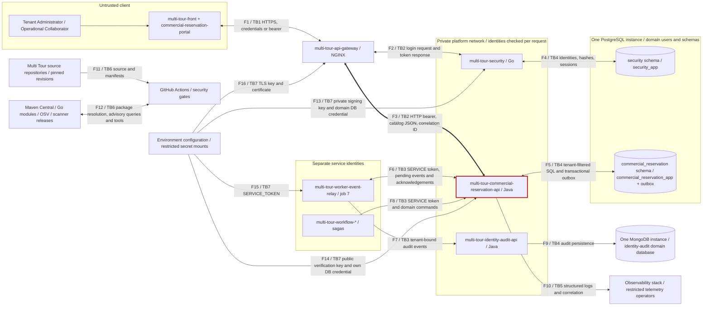

# Multi Tour threat model

Assessment date 2026-11-15. Scope follows the boundary claimed in issue #577, NGINX api-gateway to commercial-reservation-api, with security, its own persistence, event relay and CI dependencies included as supporting flows. The business journey is catalog creation, update, inactivation and reactivation by a Tenant Administrator or Operational Collaborator.

The earlier STRIDE analysis was merged on 2026-11-11. The local source exports and session 1 execution provide the implementation evidence for this assessment. The project architecture baseline is ADR-004 D4/D5/D8/D9/D10 and Annex J. Sources are listed in the session 1 source lock and the session 2 CI artifacts. [Merged PR #580](https://github.com/code-corhuila/multi-tour-docs/pull/580), [source revisions](../Sesi%C3%B3n%201/sources-lock.json), [session 1 execution](https://github.com/FernandaRobayo/sistemas-distribuidos-2026-b-g2/actions/runs/43692024222)

## Data flow and trust boundaries

The diagram is also available as a scalable standalone image. [Data-flow diagram](data-flow.svg)

The diagram is INFERIDO (source assessment 2026-11-15). Supporting services operations-cost and cash-reporting share the platform context, with their own API and PostgreSQL schema. Catalog authorization is the detailed business boundary assessed here. The relay calls the owning API for outbox access. Annex J.3 requires domain-local writes, including audit writes through identity-audit's own persistence.

| Boundary | Identity or authority that changes | Required decision |
|---|---|---|
| TB1 browser → edge | Client controls all headers and request content | TLS, bounded requests and a credential-presence filter |
| TB2 edge → service | A forwarded header becomes a candidate identity | Service validates RS256, exp and sub, then authorizes role and tenant |
| TB3 service caller → domain API | A worker/saga has a separate identity | SERVICE credential and route-specific permission, independent of network location |
| TB4 domain → datastore | Runtime role obtains data access | Domain account, own schema/database and tenant predicates |
| TB5 application → telemetry | Sensitive operational data becomes operator-readable | Redaction, correlation, restricted reads and retention |
| TB6 repositories/registries → CI | External source and packages become build inputs | Pinned source revisions, checksum-verified tools, dependency and secret gates |
| TB7 environment → process | Secret configuration becomes runtime authority | Restricted key mounts, least-privilege access and coordinated rotation |

| Asset | Sensitivity | Main flows | Security property |
|---|---|---|---|
| Password inputs and access/refresh tokens | Restricted | F1–F4 | Confidentiality, authentic origin, hash-only password/refresh persistence and bounded token lifetime |
| Private signing/TLS keys and runtime credentials | Restricted | F13–F16 | Private signer key restricted to security, consumer public-key integrity and coordinated rotation |
| Catalog rates, operational costs, capacity and status | Confidential | F3, F5 | Authorized changes and tenant isolation |
| Outbox event, actor, tenant and affected catalog identifier | Confidential | F5–F7, F9 | Integrity, replay safety and attribution |
| Correlation IDs and operational errors | Internal / potentially confidential | F3, F10 | Useful traces with credential redaction |
| Dependency inventory, source revisions and CI reports | Internal build evidence | F11–F12 | Integrity and reproducibility |

## STRIDE assessment

Likelihood and impact are INFERIDO (session 2 risk assessment). Likelihood 1 requires unusual prerequisites, 2 requires a valid account or another supporting condition, and 3 uses a routine reachable request. Impact 1 is bounded operational impact, 2 affects availability or attribution, and 3 enables unauthorized changes or tenant data exposure. Risk is likelihood × impact. Score 9 maps to P0, 6 to P1, 3–4 to P2 and 1–2 to P3. A critical advisory present in the resolved runtime graph receives P0 triage while exploitability is assessed.

| ID / STRIDE | Concrete threat and flow | L × I / priority | Existing evidence | Remaining work |
|---|---|---|---|---|
| T01 / S | A caller bypasses the gateway and presents an expired token, another signature or a different algorithm on F3 | 2 × 3 = 6 / P1 | CONFIRMADO (session 1 CI), invalid tokens and direct unauthenticated calls receive 401 | Verify service-port isolation in each promoted environment, tracked by #582 |
| T02 / T | An enabled Collaborator edits rate, cost, capacity or tenantId through PATCH on F3 | 2 × 3 = 6 / P1 | CONFIRMADO (CatalogHttpTest), strict DTO validation and role-aware changes are tested | Keep the entire restricted-field regression matrix in CI |
| T03 / R | A caller denies an inactivation, or rejected writes lack an attributable audit record across F5–F7 | 2 × 2 = 4 / P2 | Transactional outbox is specified in ADR-004 D4. Relay and outbox HTTP component tests pass | Prove committed audit attribution and denied-attempt audit data against real persistence and the receiver |
| T04 / I | Tenant B requests tenant A's serviceId and learns its rates or existence on F3/F5 | 2 × 3 = 6 / P1 | CONFIRMADO (CatalogSecurityThreatsHttpTest), foreign and absent resources produce equivalent 404 responses | Retain the two-tenant check and error-body privacy assertions, tracked by #583 |
| T05 / D | One shared-IP office exhausts the gateway budget, or a slow request consumes the API pool on F1/F3 | 2 × 2 = 4 / P2 | CONFIRMADO (gateway smoke tests), bounded requests and 429/Retry-After behavior | Assess a tenant budget and trusted-proxy address handling, then test both tenants under load |
| T06 / E | An Operational Collaborator invokes catalog create, inactivate or reactivate on F3 | 3 × 3 = 9 / P0 | CONFIRMADO (CatalogSecurityThreatsHttpTest), refused roles get 403 and successful Administrator behavior is checked | #581 still needs its complete role matrix and rejected-attempt audit acceptance criteria |
| T07 / T,E | A vulnerable runtime dependency is imported from the supply chain on F12 | 2 × 3 = 6 / P0 triage for critical findings | CONFIRMADO (OSV scan 2026-11-15), the resolved inventory has reported advisories | Upgrade or remove affected dependencies and assess reachability. The dependency gate blocks this baseline |
| T08 / S,I,E | A committed or mis-mounted signing key or service credential crosses F11/F13–F16 and is reused on F2/F3/F6 | 3 × 3 = 9 / P0 prevention | CONFIRMADO (Gitleaks scan), no unreviewed findings after exact benign-fixture classification | Enforce scanning on every change and exercise credential/key rotation |

## Residual risk and review triggers

ADR-004 D9 records cleartext transport inside the private network of one host. Host compromise remains a transport risk. A move to multiple hosts requires a transport decision and a new threat review. Audit delivery can lag or fail, so component tests provide protocol evidence while SEC-07 retains end-to-end attribution and alerting work. Gateway limits remain per IP in the assessed configuration. Dependency inventory matches establish package presence, and reachability analysis determines which vulnerable code paths the application can exercise.

Review the model after a new public route, a new role/permission, a new internal consumer, schema access changes, a proxy/cloud change, or a dependency/key-policy change. The next CI/CD activity should carry the same gates into promotion and retain the source revision and scan artifacts for each release.
