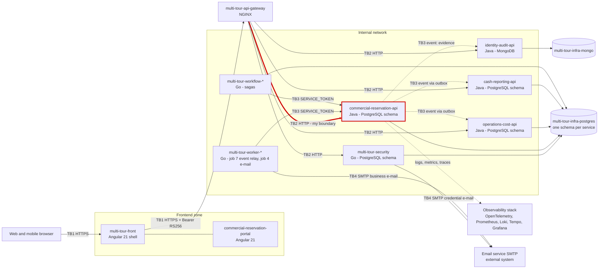
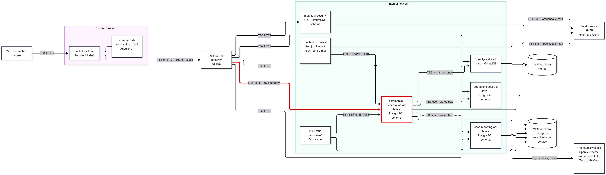

# CP1 - Attack surface map

Sources: `05-architecture/overview.md` (container diagram), `07-api/contracts/openapi/commercial-reservation.yaml`,
`06-data/data-dictionary.md`, ADR-003, ADR-004 D5 and D10, all in `code-corhuila/multi-tour-docs`.

My boundary: **TB2, api-gateway to commercial-reservation-api (inbound)**, claimed in issue #577.

## Data flow and trust boundaries

Image of the same diagram, exported from Mermaid Live as evidence:

| Id | Boundary | What crosses it |
|---|---|---|
| TB1 | Internet / browser to frontend and gateway | HTTPS requests, Bearer token |
| **TB2** | **api-gateway to domain services (mine: to `commercial-reservation-api`)** | **HTTP requests with the Bearer token already inside the internal network** |
| TB3 | Service to service, worker and workflow to service | Events from the outbox, `SERVICE_TOKEN` |
| TB4 | Platform to external SMTP service | Credential and business e-mails |

The service to its PostgreSQL schema is another boundary that I do not model, because mine stops at
the service. The thick red line is my boundary. For readability the diagram draws one portal, shows
only the observability edge of my service and groups the 8 workers and 5 sagas in one node each.

## Asset inventory

| Asset | Where it lives | In transit | Classification |
|---|---|---|---|
| Access token (RS256, claims `tenantId`, `roles`) and refresh token | `multi-tour-security` | Browser, gateway, service (TB1, TB2) | Restricted |
| Catalog item: rates, costs, capacity and high-risk mark | `commercial-reservation-api`, PostgreSQL schema | Gateway to service on `/catalog/services` (TB2) | Confidential |
| Customer sensitive data: `emergencyInfo`, medical or risk data, consents | `commercial-reservation-api`, `customers` | Not in the contract yet; will cross TB2 with the customer endpoints | Restricted |
| Customer identification: `documentNumber` | `commercial-reservation-api`, `customers` | Not in the contract yet; will cross TB2 with the customer endpoints | Confidential |
| Transfer payment proof file (up to 5 MB) | `commercial-reservation-api`, own PostgreSQL table (ADR-005 E6) | Not in the contract yet; upload route of 6 MB at the gateway (ADR-004 D10) | Confidential |
| Audit records of sensitive operations | `identity-audit-api`, MongoDB | Event: evidence (TB3) | Confidential |

## Entry points of my boundary

All six are in `commercial-reservation.yaml`. The gateway applies rate limit, body size, timeouts and
CORS (ADR-004 D10) and does not validate the token. The service validates the RS256 token itself
and takes the tenant only from the `tenantId` claim (ADR-003, ADR-004 D5).

| Entry point | Called by | Authentication today (decided, not implemented) |
|---|---|---|
| `GET /catalog/services` | Tenant Administrator, Operational Collaborator | Bearer RS256, validated in the service |
| `POST /catalog/services` | Tenant Administrator | Bearer RS256, role `TENANT_ADMINISTRATOR`, header `Idempotency-Key` required |
| `GET /catalog/services/{serviceId}` | Tenant Administrator, Operational Collaborator | Bearer RS256, item of another tenant answers `404` |
| `PATCH /catalog/services/{serviceId}` | Tenant Administrator; Collaborator only if the tenant enabled it, and only `commercialName` | Bearer RS256, other changes answer `403` |
| `POST /catalog/services/{serviceId}/inactivate` | Tenant Administrator | Bearer RS256, role `TENANT_ADMINISTRATOR` |
| `POST /catalog/services/{serviceId}/reactivate` | Tenant Administrator | Bearer RS256, role `TENANT_ADMINISTRATOR` |

The contract also has `GET /health`, which I leave out of the analysis.
